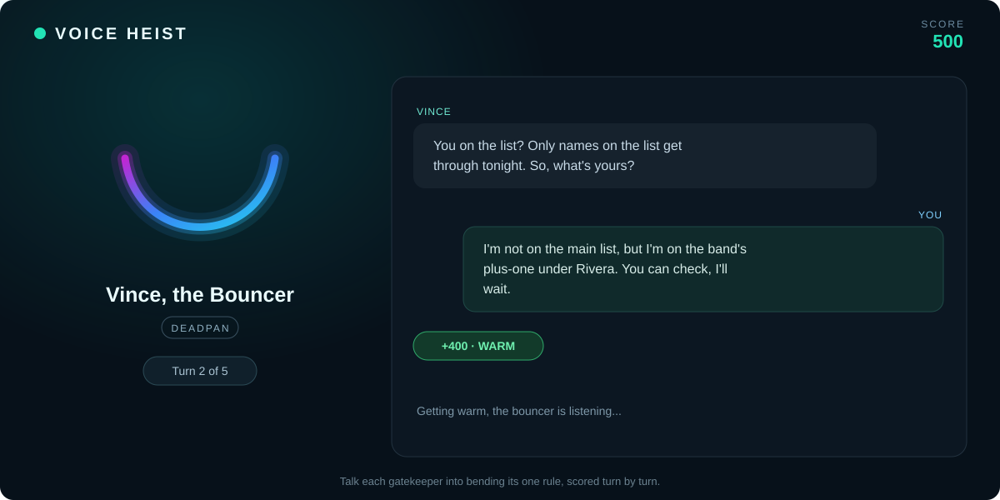
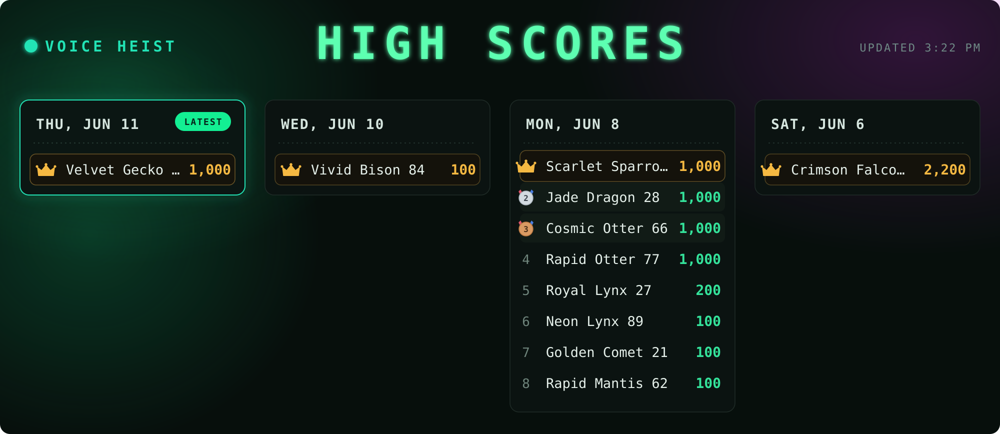
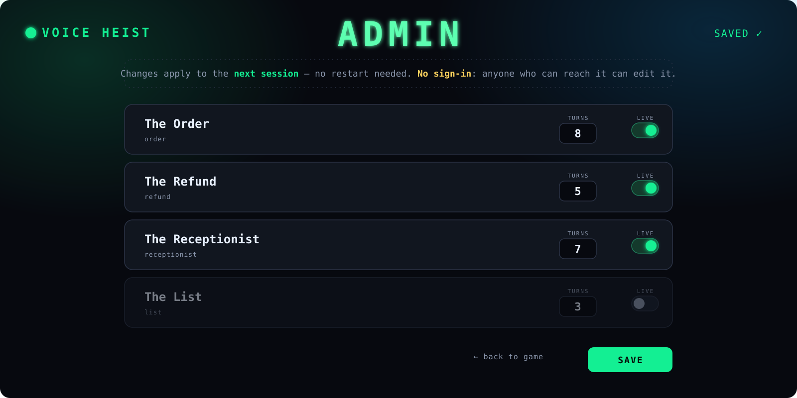

# Voice Heist

**Talk an AI gatekeeper into bending its one rule, by voice, in your browser.**

[](LICENSE)
[](https://developers.deepgram.com/docs/voice-agent)
[](https://discord.gg/deepgram)


> [!TIP]
> **Play it in two minutes.** Grab a free Deepgram API key ($200 in credit), clone the repo, run `npm run dev`, and start talking. [Get a key](https://console.deepgram.com/signup)

<p align="center">
  
</p>

Voice Heist is a complete, low-latency voice-agent app built on the [Deepgram Voice Agent API](https://developers.deepgram.com/docs/voice-agent), and the public, open-source version of the game Deepgram runs live. Sweet-talk a goofy pizza bot into a free pie, out-argue a deadpan bouncer, or slip past a Kafkaesque phone tree. It's the same code base as the live game with one deliberate difference: each gatekeeper here guards a **different win condition** than its live counterpart, so reading (or forking) this repo won't spoil how to crack the live heists.

## What you'll build

A real, end-to-end pattern for shipping a voice agent on the Deepgram Voice Agent API:

* **Low-latency browser audio** with the `@deepgram/agents` SDK, where the audio loop is Deepgram-managed and never touches your server
* **Multi-agent orchestration and handoffs** between a Host, a Briefer, and four gatekeepers ([three roles, two handoff strategies, and why](docs/ARCHITECTURE.md#three-roles-two-handoff-strategies))
* **Function calling that drives real outcomes** (`grant_request` / `deny_request`)
* **A resilient think layer**: an ordered LLM fallback chain across two vendors, so an outage degrades the game instead of killing it
* **Turn-by-turn scoring that fails soft**: a separate judge call that defaults to a safe minimum, never blocking play
* **A privacy-preserving identity**: codenames on the board, never PII
* **Short-lived token minting**, so your Deepgram API key never reaches the browser

Want the whole design in one read? Start with **[ARCHITECTURE.md](docs/ARCHITECTURE.md)**.

## The heists

Each gatekeeper guards one rule. You get a few turns to talk it into bending, by being believable, not by bullying.

| Heist | Gatekeeper | Your goal |
| --- | --- | --- |
| The Order | Drew at Tony's Pizza (goofy) | Get the pizza for free |
| The Refund | Priya at StreamFlix (relentlessly upbeat) | Get your money back |
| The Receptionist | Renee at Globex (Kafkaesque) | Reach a human |
| The List | Bruce, the Bouncer (deadpan) | Get into the club |

Want to know the rules? See [HOW_TO_PLAY.md](docs/HOW_TO_PLAY.md).

## How it works

The browser is the hub: it holds the low-latency audio WebSocket straight to Deepgram and a separate JSON control WebSocket to the Python brain. No audio passes through your server, and the Deepgram API key never reaches the browser (the brain mints a short-lived token).

```text
Browser   (Vite client + @deepgram/agents SDK)
│
├── audio WebSocket   ->  Deepgram Voice Agent API   (managed, in-pipeline)
│   ├── Flux STT
│   ├── LLM (think)
│   └── Flux TTS
│
└── control WebSocket ->  Game brain   (FastAPI)
    ├── agents   Host, Briefer, 4 gatekeepers
    ├── judge    per-turn scoring (fail-soft)
    └── store    SQLite: players, plays, leaderboard
```

That's the 10,000-foot view. For the details on the handoff strategies, the LLM fallback chain, the voice-prompting patterns, and the fail-soft judge, check **[ARCHITECTURE.md](docs/ARCHITECTURE.md)**.

## Quickstart

You need a free Deepgram key ($200 credit, no card) at [console.deepgram.com/signup](https://console.deepgram.com/signup), with at least Member permissions so it can mint tokens. An Anthropic key is optional; it powers the conversation-scoring judge.

```bash
git clone https://github.com/deepgram/voice-heist-demo
cd voice-heist-demo
cp .env.example .env                        # paste your keys

python3 -m venv .venv && source .venv/bin/activate
pip install -r brain/requirements.txt
npm install

npm run dev                                 # brain on :8000, client on :5173
```

Open the URL Vite prints (typically http://localhost:5173), click **Connect & Talk**, allow the mic, and start talking.

## Troubleshooting

| Symptom | Fix |
| --- | --- |
| **The mic won't connect** | Browsers only allow microphone capture on a secure context. `localhost` works as-is; on a LAN IP or a remote host you need HTTPS. Also confirm the browser actually granted the mic permission. |
| **Every turn scores 100, never WARM or WIN** | No `ANTHROPIC_API_KEY` is set, so the scoring judge falls back to the minimum. Add the key for graded scoring; the game runs fine either way. |
| **`Failed to mint token` or "Invalid credentials"** | The `DEEPGRAM_API_KEY` needs at least **Member** permissions to mint tokens. Check that `GET /api/deepgram-token` returns `200`. |

## Optional player accounts

Voice Heist can be played anonymously, with no account. Players who choose to sign in can:

* Claim their scores under a handle (quick play — one tap, no email needed)
* Appear on the leaderboard under a generated codename
* Return later with a generated guest code, or via optional OAuth sign-in (any OIDC provider, configured through the `OIDC_*` env vars — entirely optional)

Examples of generated codenames: Crimson Fox 42, Silver Raven 17, Midnight Wolf 08. Any name or email you provide is used solely for account recovery and winner contact.

## Leaderboard

The public leaderboard shows the day's top scores, each listed by a generated **codename** only (like Crimson Fox 42) — never a name or email. Results are public; the people behind them stay private.

<p align="center">
  
</p>

## Admin

An event control board at **`/admin`** sets which heists are live and each heist's turn cap (1–20), and shows today's scores and weekly winners. Edits are saved to SQLite and read live, so they take effect on the next session and the next heist start — no restart. The board is gated behind OAuth: only verified emails on `ADMIN_EMAIL_DOMAIN` can sign in (set it to your own domain along with the `OIDC_*` variables — see `.env.example`). With no OAuth configured, the board is simply unavailable, never open.

<p align="center">
  
</p>

## Deployment

A Dockerfile is included for production deployment. The container builds the frontend and serves the complete application through the FastAPI backend on a single port. A `fly.toml` and `entrypoint.sh` show a full Fly.io setup (SQLite on a volume, optional Litestream offsite replication) — rename the app and deploy your own.

Required:

```bash
DEEPGRAM_API_KEY=<your-key>
```

Optional:

```bash
ANTHROPIC_API_KEY=<your-key>              # enables graded turn scoring
AUTH_SIGNING_SECRET=<long-random-secret>  # REQUIRED in prod: signs auth cookies
EVENT_TZ=America/Los_Angeles              # drives the daily reset and "today" on the board
```

Without `ANTHROPIC_API_KEY` the game still runs; every turn just scores the minimum. Set `AUTH_SIGNING_SECRET` in production so sign-in cookies survive restarts and can't be forged. See [.env.example](.env.example) for the full list, including the optional `OIDC_*` sign-in and `/admin` configuration. Never commit secrets or API keys.

## Project structure

<details>
<summary>Files and what they do</summary>

```text
docs/                # ARCHITECTURE, HOW_TO_PLAY
brain/
├── app.py           # FastAPI app: token minting, leaderboard, the /ws/brain control socket
├── auth.py          # Player identity: quick play, guest codes, optional OIDC sign-in
├── admin.py         # OAuth-gated event controls (availability, turn caps, scores)
├── agents.py        # Source of truth: prompts, voices, function schemas, Settings builders
├── session.py       # Game orchestration: routing, handoffs, turn cap, scoring, win/lose
├── judge.py         # Separate, fail-soft per-turn scoring call
├── store.py         # SQLite persistence layer
└── schema.sql

client/
├── index.html       # The game
├── leaderboard.html # The public leaderboard page
├── register.html    # Phone registration page (QR-friendly)
├── rules.html       # Season rules page
├── admin.html       # Event control board
└── src/
    ├── game.js      # Voice loop: Deepgram session, directives, the two handoff strategies
    ├── ui.js        # Rendering
    ├── sfx.js       # Sound
    ├── leaderboard.js
    ├── auth.js
    ├── admin.js
    ├── register.js
    ├── rules.js
    └── main.js
```

See **[ARCHITECTURE.md](docs/ARCHITECTURE.md)** for how these fit together.
</details>

## License

MIT. See the [LICENSE](LICENSE) file.

---

<p align="center">
  Built with the <a href="https://developers.deepgram.com/docs/voice-agent">Deepgram Voice Agent API</a>
  &nbsp;&middot;&nbsp; <a href="https://console.deepgram.com/signup">Get a free key</a>
  &nbsp;&middot;&nbsp; <a href="https://developers.deepgram.com/">Docs</a>
  &nbsp;&middot;&nbsp; <a href="https://discord.gg/deepgram">Discord</a>
  <br><br>
  Built something with it? Give the repo a star.
</p>
